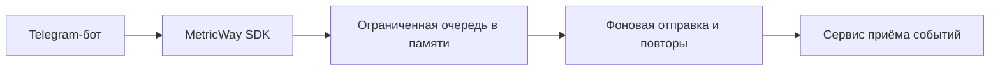

# MetricWay Python SDK

**Русский** · [English](https://github.com/urlifeceo/metricway-sdk/blob/main/README.en.md)

[](https://github.com/urlifeceo/metricway-sdk/actions/workflows/ci.yml)
[](https://pypi.org/project/metricway-sdk/)
[](https://pypi.org/project/metricway-sdk/)
[](https://github.com/urlifeceo/metricway-sdk/blob/main/LICENSE)

Асинхронный Python SDK для продуктовой аналитики Telegram-ботов в [MetricWay](https://metricway.tech). События можно отправлять вручную или собирать автоматически через aiogram 3. SDK выполняет отправку в фоне, поэтому обработчики бота сразу получают управление обратно.

<a name="installation-and-quick-start"></a>

## Установка и быстрый старт

Нужен **Python 3.10 или новее**. Создайте проект в MetricWay и сохраните его токен в переменной окружения `METRICWAY_PROJECT_TOKEN`. Токен Telegram-бота сохраните в `TELEGRAM_BOT_TOKEN`.

Установите пакет с поддержкой aiogram 3.

```bash
python -m pip install "metricway-sdk[aiogram]"
```

Сохраните пример в `bot.py` и запустите командой `python bot.py`.

```python
import asyncio
import os

from aiogram import Bot, Dispatcher
from aiogram.filters import CommandStart
from aiogram.types import Message
from metricway import MetricsClient, setup_aiogram_metrics

metrics = MetricsClient(
    api_url="https://metricway.tech",
    project_token=os.environ["METRICWAY_PROJECT_TOKEN"],
)
dp = Dispatcher()
setup_aiogram_metrics(dp, metrics)


@dp.message(CommandStart())
async def start_command(message: Message) -> None:
    await message.answer("Привет!")


async def on_startup(bot: Bot) -> None:
    await metrics.start()


async def on_shutdown(bot: Bot) -> None:
    await metrics.close()


dp.startup.register(on_startup)
dp.shutdown.register(on_shutdown)


async def main() -> None:
    bot = Bot(token=os.environ["TELEGRAM_BOT_TOKEN"])
    try:
        await dp.start_polling(bot)
    finally:
        await bot.session.close()


if __name__ == "__main__":
    asyncio.run(main())
```

Подключите `setup_aiogram_metrics` один раз к роутеру. SDK учитывает сообщения и callback-запросы даже без подходящего обработчика. В этом случае в поле имени обработчика записывается `unknown`.

Для ручной отправки событий достаточно базового пакета.

```bash
python -m pip install metricway-sdk
```

## Как устроена доставка



Методы `track_*` добавляют записи в очередь синхронно. После `await metrics.start()` фоновая задача asyncio собирает записи в батчи и отправляет их в MetricWay. При остановке вызовите `await metrics.close()`, чтобы SDK попытался отправить оставшиеся записи за отведённое время.

## Ручная отправка

```python
metrics.track_event(
    user_id=123,
    chat_id=456,
    handler="trial_started",
    update_type="trial",
    payload={"product_id": "pro_month"},
)
metrics.track_traffic(
    user_id=123,
    start_payload="campaign_a",
    utm_source="telegram",
)
metrics.track_error(
    user_id=123,
    error_type="PaymentError",
    error_message="Payment failed",
    stack="",
)
metrics.track_purchase(
    user_id=123,
    amount=990.0,
    currency="RUB",
    product_id="pro_month",
    payment_provider="telegram_payments",
)
```

Отправляйте покупку после подтверждения оплаты и учитывайте каждую оплату один раз в своём приложении. MetricWay отображает суммы в переданных валютах.

## Что собирается автоматически

| Событие | Данные |
| --- | --- |
| Входящее сообщение | ID пользователя и чата, имя обработчика, тип обновления, полный текст сообщения |
| Callback-запрос | ID пользователя и чата, имя обработчика, тип обновления, callback data |
| `/start` в личном чате | В SDK 0.2.0 создаётся запись запуска. Команда без метки считается внутренним запуском, а `/start partner_a` по умолчанию указывает на источник `partner_a` |
| Ошибка обработчика | Тип, сообщение и полный стек ошибки. Исключение передаётся дальше |

Текст сообщения, callback data и стек ошибки могут содержать персональные данные и секреты. Перед включением автоматического сбора проверьте, какие данные передаёт ваш бот. Храните токен проекта на сервере бота. SDK передаёт его в заголовке `X-Project-Token`.

### Источники трафика в SDK 0.2.0

Для трафика v2 при самостоятельном развёртывании обновите сервис приёма событий и схему ClickHouse. При несовместимости проверьте ответы на `/collector/track/traffic/v2`.

Для собственных правил атрибуции передайте `traffic_resolver` в `MetricsClient`. В примере реферальные метки объединяются под источником `referral`, а метки счетов помечаются как служебные.

```python
from metricway import TrafficSource


def resolve_traffic(payload: str) -> TrafficSource | None:
    if payload.startswith("ref_"):
        return TrafficSource(source="referral")
    if payload.startswith("invoice_"):
        return TrafficSource(purpose="service")
    return None
```

Передайте `traffic_resolver=resolve_traffic` при создании клиента. Для остальных меток SDK применяет стандартные правила. Если фиксируете запуски вручную, передайте в `track_traffic` параметры `bot_id`, `chat_id`, `message_id` и `occurred_at` с часовым поясом. Вызов без этих параметров использует прежний формат, как в примере выше.

## Настройки и ограничения доставки

| Параметр `MetricsClient` | По умолчанию | Назначение |
| --- | --- | --- |
| `batch_size` | `500` | Максимум записей для одной отправки, от 1 до 500 |
| `flush_interval` | `3.0` | Интервал фоновой отправки в секундах |
| `max_queue_size` | `10000` | Максимум записей в очереди |
| `max_retries` | `5` | Число повторов после первой попытки |
| `shutdown_timeout` | `10.0` | Время на отправку остатка при остановке в секундах |

Один запрос содержит до 500 записей и до 1 МиБ JSON. При сетевой ошибке, HTTP 429 или 5xx SDK повторяет запрос с увеличивающейся задержкой. Заголовок `Retry-After` учитывается в пределах 60 секунд.

При заполненной очереди и после `close()` новые записи отбрасываются. Очередь хранится в памяти процесса, поэтому аварийная остановка, исчерпание повторов или переполнение могут привести к потере событий. Успешный HTTP-ответ подтверждает приём батча сервисом. Запись в хранилище выполняется отдельно.

## Диагностика

1. Проверьте токен проекта и убедитесь, что при запуске бота вызывается `start()`.
2. Проверьте доступность `https://metricway.tech/collector/` с сервера бота.
3. Посмотрите сообщения логгера `metricway`. HTTP 401 указывает на проблему с авторизацией, 429 на превышение лимита запросов, 413 на слишком большой запрос.
4. Отправьте боту `/start test_campaign` и проверьте событие и источник трафика в кабинете.

## Разработка и CI

В корне репозитория создайте виртуальное окружение, установите зависимости и запустите проверки.

```bash
python -m venv .venv
# macOS / Linux
source .venv/bin/activate
# Windows PowerShell: .venv\Scripts\Activate.ps1
python -m pip install -e ".[aiogram,dev]"
python -m ruff check .
python -m ruff format --check .
python -m pytest --cov=metricway --cov-report=term-missing
python -m build
python -m twine check dist/*
```

GitHub Actions проверяет Python 3.10–3.14, запускает Ruff и pytest с порогом покрытия 85%, собирает пакет и проверяет его через `twine check`. Публикация в PyPI запускается по тегу версии через Trusted Publishing.

Подробнее о работе с репозиторием и публикации пакета. [Вклад в проект](https://github.com/urlifeceo/metricway-sdk/blob/main/CONTRIBUTING.md) · [Выпуск версии](https://github.com/urlifeceo/metricway-sdk/blob/main/RELEASING.md)

## Лицензия

[MIT](https://github.com/urlifeceo/metricway-sdk/blob/main/LICENSE).
